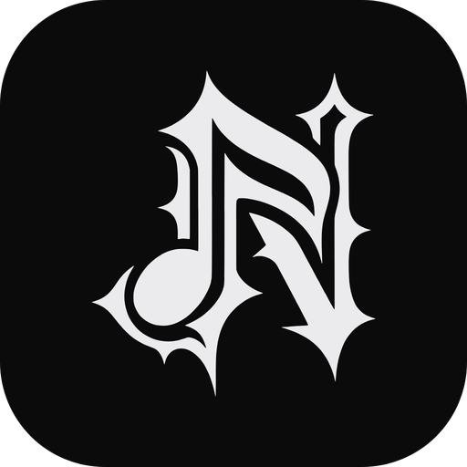
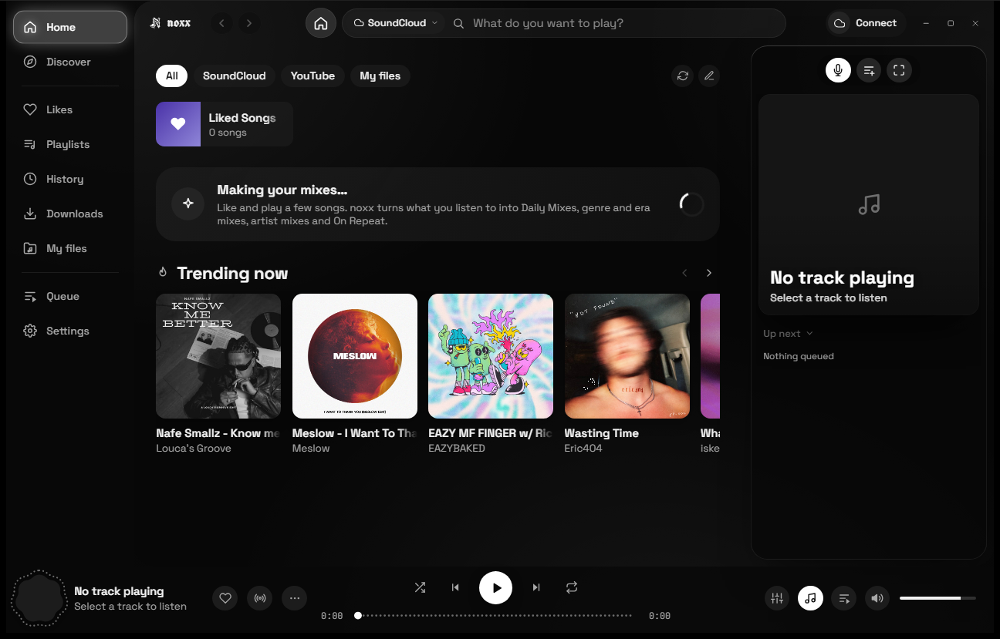
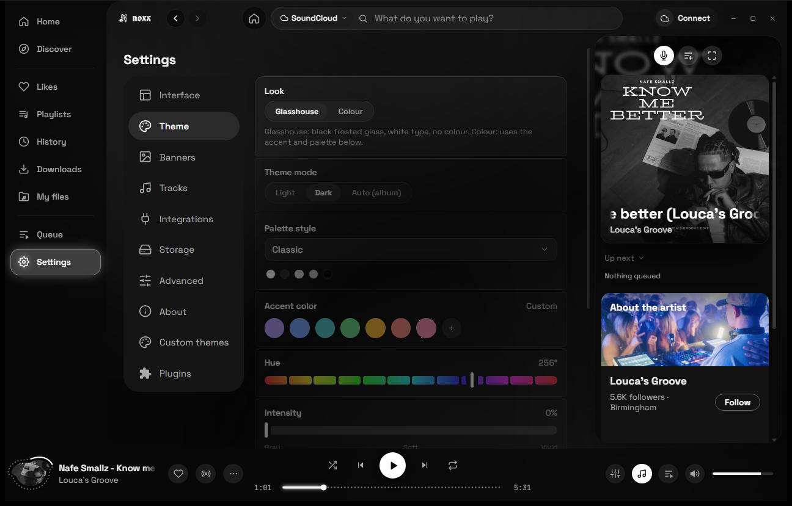

<p align="center">
  
</p>

<h1 align="center">noxx</h1>

<p align="center">
  A fast music player for SoundCloud, YouTube and YouTube Music, written in Rust.<br>
  <a href="https://github.com/T4lk/noxx/releases/latest"><b>Download for Windows, Linux and Android</b></a> ·
  <a href="https://t4lk.github.io/noxx/">Website</a>
</p>

<p align="center">
  
</p>

## Why

noxx is a rebuild of the riff music player from scratch in Rust with Tauri 2 instead of Electron.
It uses about **200 MB** of memory in total, where the Electron version used about 1.4 GB.

## Features

- **SoundCloud:** search, trending, your playlists and likes. Likes sync on launch and every 30 minutes, keep SoundCloud's order, and keep tracks you only hearted in noxx.
- **YouTube and YouTube Music:** search and play from either, with a source switch in the search bar.
- **Playlist imports:** paste a Spotify, Apple Music, SoundCloud or YouTube link. Each track is matched to a playable one and saved as a local playlist. Spotify playlists import in full (thousands of tracks) without logging in.
- **Spotify Liked songs:** sign in to Spotify inside noxx (a free account is enough, no developer app) and import your Liked songs. noxx checks the sign-in and shows it in Settings and the top bar.
- **Mini player:** a floating, always-on-top player with a spinning record or wavy cover, a progress ring, a live visualizer and like / skip buttons. It can open by itself when you minimize noxx.
- **Offline:** songs you play are cached (up to a size you pick) so they start instantly and play without internet; liked songs can download in the background. When the connection drops, noxx plays what's on your PC and skips the rest.
- **Picks up where you left off:** your queue, song and position come back after a restart, and so does the window's size and position.
- **Keyboard:** every shortcut can be changed, and any action can get a system-wide key that works while noxx is in the background. On Windows, the taskbar preview has previous / play / next buttons.
- **Lyrics:** synced lyrics with karaoke word highlighting, a full-screen karaoke mode and translation into 130+ languages. Lyrics running early or late can be nudged, for one song or all of them.
- **Sound:** EQ, effects, tempo and pitch, presets, crossfade, sleep timer.
- **Looks:** a black-and-white look by default, or a Colour look with accent colours and Material You palettes; glass cards with blur and background settings, custom themes, banner and background images or videos, a CSS editor.
- **Android:** the same app on your phone, with a phone layout, full-screen now playing, background playback and lock-screen controls.
- **Also:** Discover (mixes, artist pages, radio), history, downloads for offline play, local files (drag them onto the window), recent searches, album audio instead of the music-video version when YouTube Music has it, pause when headphones disconnect, keep the screen awake while playing, Discord Rich Presence, media keys, minimize to tray, and plugins.

## Screenshots

<p align="center">
  
  
</p>

## Install

Everything is on the [latest release](https://github.com/T4lk/noxx/releases/latest).

**Windows**

- **Installer:** `noxx_x.y.z_x64-setup.exe` installs noxx and adds Start menu and desktop shortcuts.
- **Portable:** `noxx_x.y.z_x64-portable.zip` needs no install. Unzip it anywhere (even a USB stick) and run `noxx.exe`. Your library, login and settings stay in the `data` folder next to it. To use the normal `%APPDATA%` location instead, delete the `portable` file.

Both need Windows 10 or 11 with the WebView2 runtime, which Windows 11 already has.

**Linux**

- **AppImage:** `noxx_x.y.z_amd64.AppImage` runs on most distros. Make it executable (`chmod +x`) and run it.
- **Debian / Ubuntu:** `sudo apt install ./noxx_x.y.z_amd64.deb`.

**Android**

- `noxx_x.y.z_android-arm64.apk`: open it on your phone and allow installing from your browser when Android asks. Needs a 64-bit phone running Android 7 or newer.

Every push to `main` is built for Windows, Linux and Android by GitHub Actions; the builds are under the run's artifacts. Pushing a `v*` tag publishes a release.

## Build from source

You need [Rust](https://rustup.rs) and Node.js (only for the Tauri CLI).

```sh
cd src-tauri
cargo run --release                          # run it
powershell -File ../scripts/package.ps1      # installer + portable zip into dist/
```

Tests: `cargo test` runs offline. `cargo test -- --ignored --nocapture` runs against the real services.
`RIFF_SELFTEST=1` runs the in-app self-test at startup and prints the results.

## Layout

| Path | What |
| --- | --- |
| `src-tauri/src/soundcloud.rs` | SoundCloud API client (client_id refresh, batched track hydration, stream ranking) |
| `src-tauri/src/library.rs` | Likes mirror, favourites, local playlists |
| `src-tauri/src/features/` | One module per feature: youtube, imports, lyrics, discover, downloads, themes, system and more |
| `ui/` | Plain HTML/CSS/JS frontend; each feature has its own file in `ui/features/` |
| `brand/` | Logo source files |

## Credits

- Inspired by riff.
- [hls.js](https://github.com/video-dev/hls.js) (MIT) for HLS playback.
- [UnifrakturCook](https://fonts.google.com/specimen/UnifrakturCook) (SIL OFL) for the wordmark.

## License

MIT, see [LICENSE](LICENSE). Bundled hls.js is MIT and the UnifrakturCook font is SIL OFL 1.1 (see `ui/vendor/`).
