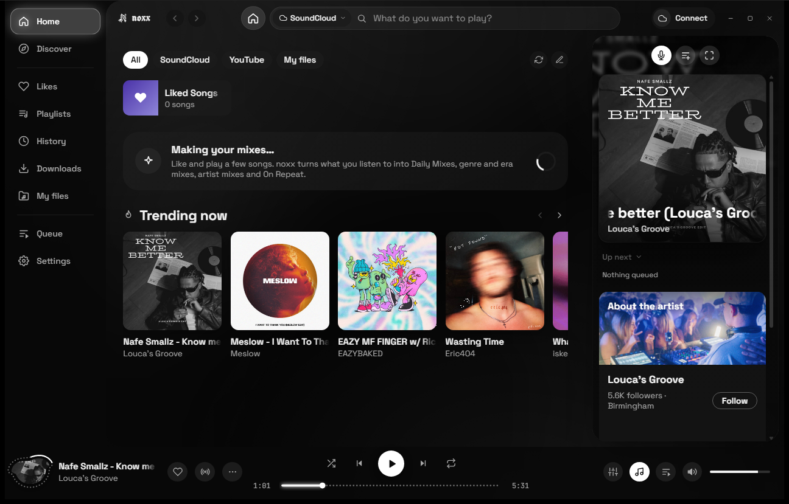

<p align="center">
  
</p>

<h1 align="center">noxx</h1>

<p align="center">
  A fast desktop music player for SoundCloud, YouTube and YouTube Music, written in Rust.<br>
  <a href="https://github.com/T4lk/noxx/releases/latest"><b>Download for Windows</b></a> ·
  <a href="https://t4lk.github.io/noxx/">Website</a>
</p>

<p align="center">
  
</p>

## Why

noxx is a rebuild of the riff music player from scratch in Rust with Tauri 2 instead of Electron.
It uses about **230 MB** of memory in total, where the Electron version used about 1.4 GB.

## Features

- **SoundCloud:** search, trending, your playlists and likes. Likes sync on launch and every 30 minutes, keep SoundCloud's order, and keep tracks you only hearted in noxx.
- **YouTube and YouTube Music:** search and play from either, with a source switch in the search bar.
- **Playlist imports:** paste a Spotify, Apple Music, SoundCloud or YouTube link. Each track is matched to a playable one and saved as a local playlist.
- **Lyrics:** synced lyrics with karaoke word highlighting, a full-screen karaoke mode and translation into 130+ languages.
- **Sound:** EQ, effects, tempo and pitch, presets, crossfade, sleep timer.
- **Looks:** the Glasshouse theme by default, accent colours, Material You palettes, custom themes, banner and background images or videos, a CSS editor.
- **Also:** Discover (mixes, artist pages, radio), history, downloads for offline play, local files, Discord Rich Presence, media keys, minimize to tray, and plugins.

## Install

Grab `noxx_x.y.z_x64-setup.exe` from the [latest release](https://github.com/T4lk/noxx/releases/latest) and run it.
It needs Windows 10 or 11 with the WebView2 runtime, which Windows 11 already has.

## Build from source

You need [Rust](https://rustup.rs) and Node.js (only for the Tauri CLI).

```sh
cd src-tauri
cargo run --release                          # run it
npx @tauri-apps/cli@^2 build --bundles nsis  # build the installer
```

Tests: `cargo test` runs offline. `cargo test -- --ignored --nocapture` runs against the real services.
`RIFF_SELFTEST=1` runs the in-app self-test at startup and prints the results.

## Layout

| Path | What |
| --- | --- |
| `src-tauri/src/soundcloud.rs` | SoundCloud API client (client_id refresh, batched track hydration, stream ranking) |
| `src-tauri/src/library.rs` | Likes mirror, favourites, local playlists |
| `src-tauri/src/features/` | One module per feature: youtube, imports, lyrics, discover, downloads, themes, system and more |
| `ui/` | Plain HTML/CSS/JS frontend; each feature has its own file in `ui/features/` |
| `brand/` | Logo source files |

## Credits

- Inspired by riff.
- [hls.js](https://github.com/video-dev/hls.js) (MIT) for HLS playback.
- [UnifrakturCook](https://fonts.google.com/specimen/UnifrakturCook) (SIL OFL) for the wordmark.

## License

MIT, see [LICENSE](LICENSE). Bundled hls.js is MIT and the UnifrakturCook font is SIL OFL 1.1 (see `ui/vendor/`).
